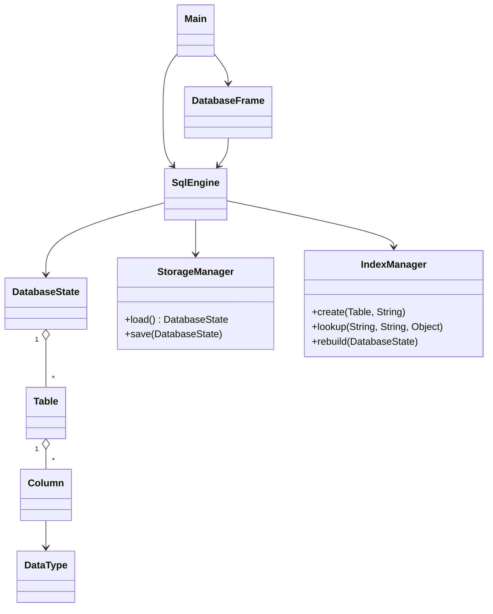
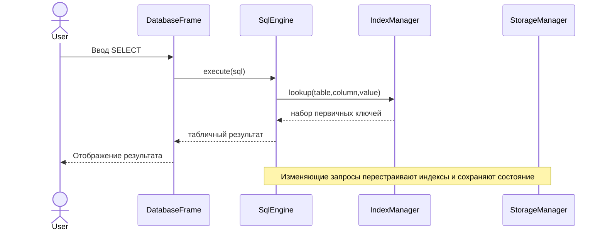

# Выполнил Солдатов Вадим Павлович 25кнт5
# MiniDB — файловая СУБД с графическим интерфейсом

 СУБД на Java 8+ с графическим интерфейсом Swing, SQL-язык, сериализацией данных и hash-индексами. Предметная область демонстрационной схемы — автомобильный салон (`owners`, `cars`).

## Возможности

- GUI: список таблиц, просмотр записей в JTable, SQL-редактор, вывод результата и ошибок.
- Графические операции добавления, изменения и удаления строк.
- Создание и удаление таблиц, создание индексов.
- SQL: `CREATE TABLE`, `DROP TABLE`, `CREATE INDEX`, `INSERT`, `SELECT`, `UPDATE`, `DELETE`.
- Типы: `INT`, `DOUBLE`, `STRING`, `DATE`, `BOOLEAN`.
- Первичные ключи и проверка уникальности; внешние ключи `REFERENCES`.
- Hash-индексы для поиска по равенству; индексы сохраняются и восстанавливаются.
- Данные хранятся в `data/minidb.db`, индексы — в `data/indexes.db`.
- Консольный режим для демонстрации и автоматические тесты без сторонних библиотек.

## Архитектура

| Класс | Ответственность |
|---|---|
| `Main` | Запуск GUI или консольного режима |
| `DatabaseFrame` | Swing-интерфейс |
| `SqlEngine` | Разбор и выполнение SQL-подобных команд, ограничения целостности |
| `Table`, `Column`, `DataType` | Модель схемы и типов |
| `DatabaseState` | Сериализуемое состояние БД |
| `StorageManager` | DAO: загрузка и атомарное сохранение |
| `IndexManager` | Построение, поиск, восстановление и сохранение hash-индексов |
| `SelfTest` | Автоматические функциональные проверки |
| `Benchmark` | Сравнение поиска с индексом и без него |

### Диаграмма классов



### Последовательность SELECT с индексом



## Запуск на Windows

Открой PowerShell в корне распакованного проекта.

```powershell
mkdir out
javac -encoding UTF-8 -d out src/minidb/*.java
java -cp out minidb.Main
```

Откроется графическое окно MiniDB. Для консольного режима:

```powershell
java -cp out minidb.Main --console
```

Требуется JDK 8 или новее. Внешние библиотеки не используются.

## Работа с GUI

1. Выбери таблицу `owners` или `cars` слева.
2. Таблица записей отображается в центральной области.
3. Кнопки «Добавить запись», «Изменить запись» и «Удалить запись» выполняют операции через SQL-движок.
4. В нижнем SQL-редакторе можно вводить запросы вручную.
5. «Создать индекс» создаёт индекс для выбранного столбца.
6. «Новая таблица» открывает редактор команды `CREATE TABLE`.
7. В нижней области отображаются результат выполнения и ошибки.

## Примеры SQL

```sql
INSERT INTO owners VALUES (1, 'Иван Петров', '1995-04-12', TRUE);
INSERT INTO owners VALUES (2, 'Анна Смирнова', '1998-11-03', TRUE);
INSERT INTO cars VALUES (1, 'Toyota', 25000.0, TRUE, 1);
INSERT INTO cars VALUES (2, 'BMW', 42000.0, FALSE, 2);

SELECT * FROM cars;
SELECT brand, price FROM cars WHERE price > 20000;
UPDATE cars SET price = 30000 WHERE id = 2;
DELETE FROM cars WHERE id = 2;

CREATE INDEX idx_cars_brand ON cars (brand);
SELECT * FROM cars WHERE brand = 'Toyota';

CREATE TABLE service (
    id INT PRIMARY KEY,
    car_id INT REFERENCES cars(id),
    cost DOUBLE,
    service_date DATE,
    completed BOOLEAN
);
DROP TABLE service;
```

Поддерживается одно простое условие `WHERE` с операторами `=`, `!=`, `<>`, `>`, `<`, `>=`, `<=`. Для `INSERT` допускаются несколько наборов `VALUES`. Даты вводятся в формате `yyyy-MM-dd`, строки и даты — в одинарных кавычках.

## Тестирование

Скомпилируйте проект и запустите:

```powershell
java -cp out minidb.SelfTest
```

Набор проверяет вставку, первичный ключ, внешний ключ, создание/использование индекса, UPDATE, DELETE, восстановление после перезапуска и запрет удаления родительской записи при наличии дочерней ссылки.

## Измерение производительности

Запуск по умолчанию на 20 000 строк:

```powershell
java -cp out minidb.Benchmark
```

Или задать объём:

```powershell
java -cp out minidb.Benchmark 100000
```

Программа выводит время вставки, 30 запросов без индекса и 30 запросов с индексом, а также отношение времени. Для отчёта выполните замеры несколько раз, исключите первый прогон, зафиксируйте компьютер/JDK и внесите фактические результаты в таблицу:

| Число строк | Без индекса, мс | С индексом, мс | Ускорение |
|---:|---:|---:|---:|
| 20 000 | заполнить после запуска | заполнить после запуска | вычислить |
| 100 000 | заполнить после запуска | заполнить после запуска | вычислить |

Hash-поиск в среднем имеет сложность O(1) для нахождения корзины и O(k) для выдачи k совпадений; полный просмотр — O(n). Перестроение индекса после изменения таблицы стоит O(n). Замеры зависят от среды и не должны подменяться заранее придуманными цифрами.

## Надёжность и ограничения

Состояние сериализуется в бинарный файл. Сохранение выполняется через временный файл с атомарным перемещением, если это поддерживает файловая система. Индексы перестраиваются из таблиц при запуске, поэтому их файл может быть восстановлен. При ошибке чтения базы исходный файл не удаляется, но приложение запускается с пустым состоянием — перед дальнейшей работой нужно сохранить повреждённый файл для диагностики.

Это учебный прототип, а не промышленная СУБД. Нет транзакций/WAL, конкурентного доступа, JOIN, ORDER BY, агрегатов и нескольких условий WHERE. При удалении родительской записи и удалении таблицы проверяются существующие внешние ссылки. Обновление и пакетная вставка откатываются в памяти при ошибке валидации.

## Ответственность участников

Индивидуальная работа
## Выводы

Создана файловая учебная СУБД с GUI и консольным режимом, двумя связанными таблицами, поддержкой пяти типов данных, SQL-подобными командами, ограничениями ключей, сериализацией и hash-индексацией. Графический интерфейс делает основные операции доступными без ручного ввода SQL, а SQL-редактор сохраняет возможность демонстрировать язык запросов. Дальнейшие направления развития — WAL, транзакции, JOIN, B+Tree и многопользовательский доступ.

## Источники

- Java SE 8 API: https://docs.oracle.com/javase/8/docs/api/
- Java Swing Tutorial: https://docs.oracle.com/javase/tutorial/uiswing/
- Java Object Serialization: https://docs.oracle.com/javase/8/docs/platform/serialization/spec/serialTOC.html
- Java NIO Files: https://docs.oracle.com/javase/8/docs/api/java/nio/file/Files.html
- SQLite Documentation: https://www.sqlite.org/docs.html
